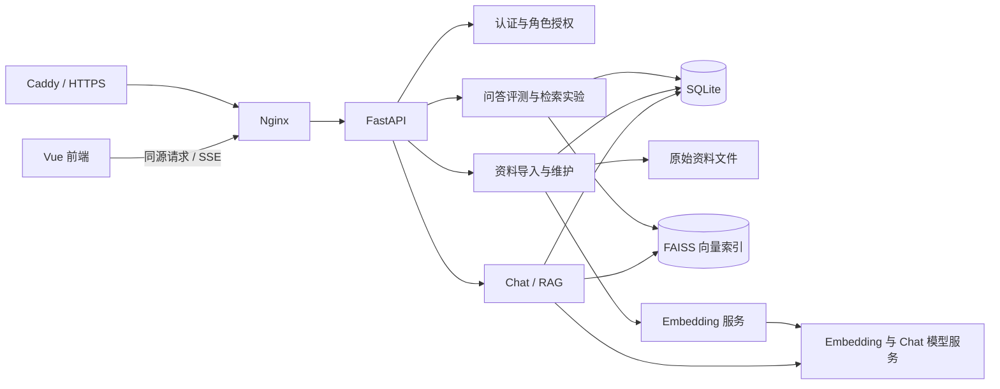

# LaborQA 项目当前开发情况

> **更新日期：2026-11-17**<br>
> 本文汇总项目结构与代码能力；第 7 节和 [`docs/assessment/2026-11/`](docs/assessment/2026-11/01_项目简介与系统架构.md) 记录本次测试、隔离浏览器验收、Baseline v4 和 A/B 实验的实际结果。代码已在本地考核分支，但尚未发布或部署到生产。

## 1. 项目概况

LaborQA（Labor Rights QA）是一个面向劳动权益咨询的证据优先型 RAG 问答与知识运营平台。它将劳动法律法规、政策和辅助案例整理为可检索知识库，用户通过自然语言提问，系统检索资料并返回带来源依据的回答。

产品设计强调以下边界：

- 回答应以知识库中检索到的证据为依据，并展示来源文件和原文片段。
- 检索证据不足时可以拒答，并把知识缺口沉淀下来供后续维护。
- 评测和检索实验尽可能复用生产问答链路，减少离线结果与线上行为不一致。
- SQLite 和文件目录保存业务数据；FAISS 作为可从成功分块重建的向量索引。
- 劳动权益回答属于信息辅助，不替代律师、仲裁机构、行政机关或其他专业人士提供的正式意见。

整体产品和部署说明见[根目录 README](README.md)。

## 2. 技术栈与运行结构

| 层次 | 当前使用的技术 | 主要职责 |
| --- | --- | --- |
| 前端 | Vue 3、TypeScript、Vite、Vue Router、Pinia、Element Plus | 咨询工作台、资料管理、评测、检索实验及状态页面 |
| 后端 API | Python 3.11+、FastAPI、Pydantic Settings、Uvicorn | REST API、SSE 流式问答、业务权限和应用生命周期管理 |
| RAG | LangChain、FAISS、Embedding、OpenAI-compatible Chat API | 查询改写、候选检索、重排、证据判断、回答生成 |
| 持久化 | SQLite、本地上传目录、FAISS 索引目录 | 保存账号、会话、资料、分块、评测、实验及向量索引 |
| 文档处理 | pypdf、python-docx、msdoc2docx；部署可用 LibreOffice | 读取 PDF、DOC、DOCX、MD、TXT 资料并转换、分块 |
| 部署 | Docker Compose、Caddy、Nginx | TLS 入口、静态资源托管、API 反向代理和 SSE 转发 |



后端的分层和启动顺序见[后端代码地图](backend/README.md)，前端结构见[前端 README](frontend/README.md)，生产部署流程见[部署说明](deploy/README.md)。

## 3. 现有业务能力

以下内容是从当前代码和项目文档确认的功能范围。哪些能力已经自动化测试、浏览器验收或生产验证，分别见第 7、10 节和考核材料。

| 模块 | 当前具备的能力 |
| --- | --- |
| AI 咨询 | 多轮会话、问题改写、Top-k 召回、可选重排、证据门控、SSE 流式回答、引用来源展示 |
| AI 模式 | `speed`、`balanced`、`quality` 三档运行配置；回答风格（通俗解读 / 严谨条款）为独立设置 |
| 资料管理 | PDF、DOC、DOCX、MD、TXT 上传；后台导入、解析、清洗、分块、向量化；失败重导入、分块查看和删除 |
| 系统资料 | 扫描 `reference-data/documents/`；基于相对路径和 SHA-256 识别系统资料版本，支持缺失、失败和过期状态管理 |
| 咨询辅助 | 材料清单工具、合规提示、拒答时记录知识缺口 |
| 知识缺口 | 查询和维护由拒答链路产生的知识缺口记录 |
| 问答评测 | 内置评测用例、运行真实问答链路、逐题结果及正确性、拒答、引用等指标 |
| 检索策略实验 | 检索策略版本管理、Preview、隔离实验索引、参数对比和实验结果保存 |
| 系统状态 | 检查数据库、Embedding、FAISS、模型配置及文档转换能力；公共存活检查与详细健康检查分开 |
| 部署运维 | Docker Compose、Caddy HTTPS、Nginx API/SSE 代理、备份恢复说明 |

### 3.1 一次问答的主要链路

```text
创建或选择会话
→ 读取历史消息并按需改写问题
→ FAISS 候选检索
→ 可选重排与相邻分块扩展
→ 判断证据是否足以作答
→ 调用材料清单工具、生成回答或拒答
→ 通过 SSE 返回状态、工具结果、回答片段和来源
→ 保存消息、引用、工具执行与知识缺口
```

### 3.2 一次资料导入的主要链路

```text
接收上传文件或选取系统资料
→ 文档解析与文本清洗
→ 按劳动法律文本规则分块
→ 生成 Embedding
→ 保存资料与 Chunk 到 SQLite
→ 更新生产 FAISS 索引
→ 记录成功或失败状态
```

SQLite 中的成功 Chunk 是索引重建依据。FAISS 负责向量召回，不作为资料、会话或评测记录的权威来源。

## 4. 代码与数据目录

| 路径 | 用途 |
| --- | --- |
| `backend/app/api/` | FastAPI 路由、请求依赖、认证、管理和健康检查 |
| `backend/app/core/` | 配置、SQLite 初始化和迁移、数据库 Schema、错误处理、日志 |
| `backend/app/rag/` | LangChain 链、Embedding、模型 Provider、文档 Loader、分块和运行配置 |
| `backend/app/repositories/` | SQLite 查询、写入和事务边界 |
| `backend/app/services/` | Chat、资料、向量库、评测、检索实验、知识缺口和认证业务流程 |
| `backend/app/prompts/` | 问题改写、证据判断、回答和评测提示词 |
| `backend/tests/` | 后端服务、API、RAG、数据库和认证相关测试 |
| `frontend/src/views/` | 咨询、系统、资料、评测、知识缺口、实验、登录和账号管理页面 |
| `frontend/src/components/` | Chat、来源、工具、资料列表与分块等页面组件 |
| `frontend/src/api/` | Axios API 客户端和业务 API 封装 |
| `frontend/src/stores/` | 登录身份、聊天会话和用户偏好等 Pinia Store |
| `frontend/tests/` | 前端组件和页面测试 |
| `reference-data/documents/` | 随仓库维护的系统初始知识资料 |
| `data/`、`uploads/`、`model-cache/` | 本地运行数据、上传工作副本和模型缓存；运行时内容不应当作源代码提交 |
| `docs/devdocs/` | 历史设计、修复和实施方案 |

## 5. 工作区正在开发：登录、账号与权限

### 5.1 状态判断

当前开发重点是把认证和权限接入既有问答台。实现横跨后端、前端、数据库迁移、部署配置和测试。本次在专用分支运行了完整自动化测试，并对登录、刷新恢复和问答 SSE 做了隔离浏览器验证；这仍不等于已合并版本或生产验收结论。

### 5.2 后端实现范围

- 账号密码使用 Argon2 哈希；公开管理 API 不允许创建系统管理员。
- 登录后使用随机会话令牌写入 HttpOnly Cookie，SQLite 保存令牌摘要。
- 会话具备空闲过期和绝对过期时间；服务端可撤销单个会话或某账号的全部会话。
- 写请求同时检查可信来源和 CSRF Token；CSRF Token 在服务端保存摘要，前端只保存在页面内存。
- 登录失败按账号和来源 IP 限流；登录、登出、账号变更等操作记录审计事件。
- 提供开发环境管理员初始化开关；生产环境应通过交互式离线 CLI 初始化系统管理员。
- 既有聊天会话增加所有者字段。无法归属到新用户的历史会话迁移为隔离状态，不自动暴露给新账号。
- 资料、知识缺口、评测、检索实验和健康状态 API 在服务端进行角色校验，权限不只依赖前端隐藏菜单。

相关代码主要在：

- `backend/app/services/auth_service.py`
- `backend/app/repositories/auth_repository.py`
- `backend/app/api/auth.py`
- `backend/app/api/admin.py`
- `backend/app/api/dependencies.py`
- `backend/app/core/schema.sql`、`backend/app/core/database.py`
- `backend/app/cli.py`

### 5.3 当前角色权限划分

| 角色 | 当前代码中的主要权限 |
| --- | --- |
| `USER` | 使用咨询功能；读取资料；访问公共业务页面范围 |
| `KNOWLEDGE_ADMIN` | 普通用户权限；写入或管理资料；维护知识缺口 |
| `SYSTEM_ADMIN` | 全部管理范围，包括系统状态、问答评测、检索策略与实验、账号管理 |

具体路由仍以服务端授权依赖为准，前端路由和导航仅负责展示体验，不构成安全边界。

### 5.4 当前认证 API 范围

| API | 用途 |
| --- | --- |
| `POST /api/auth/login` | 验证账号密码并建立会话 Cookie |
| `GET /api/auth/me` | 恢复当前身份并轮换 CSRF Token |
| `POST /api/auth/logout` | 撤销当前会话 |
| `POST /api/auth/change-password` | 修改密码并更新会话 |
| `GET /api/auth/sessions` | 查看本人服务端会话 |
| `DELETE /api/auth/sessions/{session_id}` | 撤销本人指定会话 |
| `GET /api/admin/users` | 管理员列出账号 |
| `POST /api/admin/users` | 管理员创建普通用户或知识管理员 |
| `PATCH /api/admin/users/{user_id}` | 管理员调整账号角色或启用状态 |
| `POST /api/admin/users/{user_id}/revoke-sessions` | 管理员撤销指定账号全部会话 |

### 5.5 前端实现和待补齐处

当前工作区新增登录页、登录状态 Store、Axios Cookie/CSRF 处理、路由守卫、角色导航和账号管理页面。主要代码位于 `frontend/src/api/auth.ts`、`frontend/src/stores/auth.ts`、`frontend/src/router/index.ts`、`frontend/src/views/LoginView.vue` 和 `frontend/src/views/UsersView.vue`。

后端已经提供修改密码和本人会话管理 API；新增安全测试验证了密码变更、当前会话轮换和其他会话撤销。当前页面路由中没有个人安全设置页面，因此自助管理界面仍属于后续工作。浏览器同源开发环境下登录和 SSE 已验收；生产 HTTPS 反向代理、Cookie 和上传仍待 Docker 候选环境验证。

## 6. Git 与改动状态

- 当前工作分支为 `feature/lab-assessment-20261117`，从原工作区 HEAD `45e28d397772e556cd0dda22000cd9321a480d61` 创建；原始本地工作未被清理或重置。
- 认证主体、代码质量修复、测试和考核材料都在该分支进行审核。提交完成后在此更新 commit SHA、暂存范围、远端 PR 状态。
- `.DS_Store`、`.agents/`、`frontend/prototypes/`、`frontend/src/prototypes/`、`LoginPrototype.vue`、`uv.lock` 和运行数据不属于预期发布内容。
- `docs/` 默认仍被忽略；仅 `docs/assessment/2026-11/` 考核材料目录解除忽略。
- 不直接合并 `main`、打发布 tag 或部署公网。当前 Docker / HTTPS 门禁未通过，详见第 7 节。

## 7. 验证情况与未确认事项

### 7.1 已运行的自动化检查

- 后端 pytest：`226 passed, 1 skipped, 1 warning`；新增密码修改回归覆盖 CSRF、密码替换、当前会话轮换和旧会话撤销。
- Ruff check：通过；Ruff format：91 个 Python 文件已格式化。
- 前端 Vitest：11 个测试文件、63 项通过。
- 前端生产构建：通过；有 JS 674.73 kB 和 CSS 470.24 kB 体积提示。
- Embedding 离线检查通过，维度 512。
- SQLite 副本上的重复 schema 初始化幂等，23 个会话保留（19 个旧会话隔离、4 个 owned），无外键问题。

### 7.2 已完成的隔离浏览器验收

- 登录、刷新身份恢复和权限导航通过。
- 10 份内置资料导入成功，共 705 个 Chunk。
- 劳动关系问题流式回答、多轮追问、引用原文展开通过。
- 企业内部资料缺失问题正确拒答，知识缺口页面可查到 1 条聚合记录。
- Baseline v4：60/60 执行完成；应回答自动判分 38/42，应拒答命中 18/18，最终来源命中和检索来源命中各 40/41，多轮通过率 9/10。
- 检索实验 ID 1：600/100 与 400/100 分块在 10 题对比，20/20 完成；A 应答判分 6/7，B 为 4/7。

### 7.3 尚未验证或未完成

- 当前环境没有 Docker、Podman、Nginx 或 Caddy CLI，因此未验证 Compose 配置渲染、容器启动、Caddy TLS、Nginx SSE/上传反代和 HTTPS Cookie。
- 未操作或升级生产服务；也没有在考核设备完成彩排。
- Baseline 是模型自动判分，不等于专业法律复核；#4、#17、#32、#36 是应回答但判分未通过的样例，需参考报告复核。
- GitHub 远端分支、PR、tag / release 尚未发布；生产候选版不能宣布已就绪。

具体数据与截图见[考核验收矩阵](docs/assessment/2026-11/02_功能验收记录.md)、[Baseline 报告](docs/assessment/2026-11/03_基准评测报告.md)、[检索实验](docs/assessment/2026-11/04_检索策略对照实验.md)和[部署恢复记录](docs/assessment/2026-11/06_部署与恢复记录.md)。

## 8. 本地开发入口

项目 README 已提供完整环境准备说明。典型 macOS/Linux 启动方式如下：

首次安装在仓库根目录执行：

```bash
cp .env.example .env
python3.11 -m venv backend/.venv
backend/.venv/bin/python -m pip install -r backend/requirements.txt
```

在后端终端启动 API：

```bash
cd backend
.venv/bin/python -m uvicorn app.main:app --reload --host 127.0.0.1 --port 8000
```

在另一个终端启动前端：

```bash
cd frontend
npm ci
npm run dev
```

认证开发配置在 `.env.example` 中启用了开发环境管理员 seed；该设置只允许 `APP_ENV=development`。生产环境示例关闭自动 seed，应在后端环境中通过以下命令交互式创建首位系统管理员：

```bash
cd backend
.venv/bin/python -m app.cli init-admin --login-identifier <管理员账号>
```

生产部署还需要按[部署环境变量说明](deploy/README.md#4-环境变量与密钥)设置安全 Cookie、可信域名和稳定随机密钥，不应直接沿用开发环境配置。

## 9. 关键文档索引

| 文档 | 适合阅读的内容 |
| --- | --- |
| [根目录 README](README.md) | 产品能力、架构、快速启动、配置和 API 入口 |
| [后端 README](backend/README.md) | 服务分层、模块职责、启动生命周期和业务流 |
| [前端 README](frontend/README.md) | 路由、组件、Store、API Client 和前端验证 |
| [部署 README](deploy/README.md) | Docker Compose、Caddy、备份恢复及生产运维 |
| [系统参考资料说明](reference-data/README.md) | 法规资料来源约定、导入机制和内容维护门禁 |
| `docs/devdocs/` | 各阶段设计、RAG 修复、评测和检索实验方案 |
