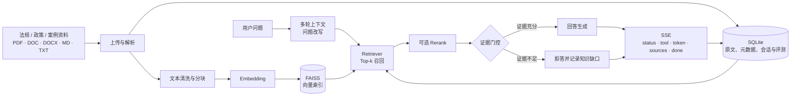

<p align="center">
  
</p>

<h1 align="center">LaborQA · 劳动权益咨询问答台</h1>

<p align="center">
  面向劳动权益场景的证据优先型 RAG 问答与知识运营平台
</p>

<p align="center">
  <code>Vue 3</code> · <code>FastAPI</code> · <code>LangChain</code> · <code>FAISS</code> · <code>SQLite</code> · <code>Docker Compose</code> · <code>Caddy</code> · <code>Nginx</code>
</p>

<p align="center">
  <a href="#快速开始">快速开始</a> ·
  <a href="#系统架构">系统架构</a> ·
  <a href="#配置指南">配置指南</a> ·
  <a href="#部署与运维">部署与运维</a> ·
  <a href="#文档索引">文档索引</a>
</p>

> [!IMPORTANT]
> LaborQA 是劳动权益信息辅助工具，不替代律师、仲裁机构、行政机关或其他专业人士提供的正式法律意见。回答的可靠性取决于已导入资料的完整性、时效性、检索配置和模型服务质量。

## 项目定位

LaborQA（Labor Rights QA）将法规、政策、案例和内部知识资料组织成可检索的证据库，让用户以自然语言完成劳动权益咨询。系统的核心原则不是“让模型尽量回答”，而是：

- **Evidence first**：回答必须建立在当前知识库检索到的证据上。
- **可追溯**：回答同步返回命中的文件、分块和原文片段，便于复核。
- **证据不足则拒答**：检索不到资料或证据相关性不足时，系统明确提示依据不足，并记录知识缺口。
- **普通交互有受控直答**：仅完整匹配的简短问候、感谢、告别、身份和功能询问使用固定回复；混合问题及无法确定的输入继续走原有 RAG 证据链。
- **可评测、可调优**：问答评测和检索实验共用真实链路，用指标支持配置决策。
- **本地可控**：业务数据、上传文件、SQLite 和 FAISS 索引默认保存在部署环境内。

## 核心能力

| 能力模块 | 解决的问题 | 已实现能力 |
| --- | --- | --- |
| 证据优先问答 | 如何让回答有依据、可复核 | 多轮会话、问题改写、Top-k 检索、可选重排、证据门控、来源片段、SSE 流式回答 |
| 劳动法规知识库 | 如何将资料变成可用知识 | 支持 PDF、DOC、DOCX、MD、TXT；异步导入、解析、清洗、分块、向量化；失败重导入；分块明细查看 |
| 咨询辅助工具 | 如何把回答落到行动 | 通俗解读 / 严谨条款两种回答风格、材料清单、合规提示、知识缺口沉淀 |
| 问答质量评测 | 如何知道回答是否可靠 | 内置单轮、多轮和拒答用例；支持正确性、拒答率、引用命中率等指标 |
| 检索策略实验 | 如何选择更合适的 RAG 参数 | 比较分块大小、重叠长度、Top-k、相似度阈值、重排开关和重排候选数；支持快速试跑与正式实验 |
| 运行状态与运维 | 如何发现服务和索引问题 | API、数据库、文档转换器、Embedding、向量索引和 LLM 配置状态检查；Docker 健康检查、备份与恢复 |

## 系统架构



### 一次问答的处理链路

1. **理解上下文**：读取当前会话最近几轮消息，必要时将省略表达改写成独立问题。
2. **召回候选证据**：使用当前 Embedding 和 FAISS 索引进行 Top-k 召回；SQLite 作为分块内容和来源元数据的权威数据源。
3. **调整证据顺序**：根据配置决定是否执行领域重排，并保留检索分数、重排分数和排名信息。
4. **执行证据门控**：综合空结果、相关性阈值和证据判断链，决定回答还是拒答。
5. **生成可读回答**：在证据范围内调用 OpenAI-compatible Chat Completions 服务；可选择通俗或严谨风格，并按规则附加合规提示。
6. **流式返回与落库**：通过 Server-Sent Events 推送工具结果、回答 token、来源和完成状态，同时保存会话消息与引用。

### 设计上的关键边界

- **SQLite 是业务真源，FAISS 是可重建索引**：文件、分块、来源、会话、评测和实验记录以 SQLite / 文件存储为准，向量索引只负责高效召回。
- **生产问答与评测 / 实验复用同一条 RAG 链路**：减少“评测路径和线上路径不一致”造成的误判。
- **配置变更会影响索引兼容性**：Embedding Provider、模型、归一化方式、分块参数变化后，旧索引可能不再兼容，需要重建知识库索引。

## AI 运行模式

AI 模式是随请求传递的产品级运行档位，不写入 `.env`。前端的全局 `AiModeSelector` 将当前选择保存到浏览器 `localStorage`，聊天请求携带该模式；评测和检索实验会在运行配置快照中记录模式，保证结果可复现。

| 模式 | 默认标签 | Evidence Judge | Answer thinking | 适用场景 |
| --- | --- | --- | --- | --- |
| `speed` | 快速 | 关闭 | 关闭 | 优先响应速度 |
| `balanced` | 均衡（默认） | `LOW` | 关闭 | 日常咨询，在速度和质量间平衡 |
| `quality` | 高质量 | `HIGH` | `HIGH` | 复杂问题和更高质量要求 |

三档模式只改变 RAG 运行时的模型推理配置，不改变资料、SQLite 或 FAISS 的持久化结构。回答风格（通俗解读 / 严谨条款）是另一项独立设置。

### 后端启动生命周期

```text
configure_logging
→ initialize_database
→ DocumentService（恢复中断的资料导入）
→ SessionService
→ RetrievalService（复用资料服务的 Repository、Embedding 和 production VectorStore）
→ ChatService
→ EvaluationService.initialize
→ RetrievalExperimentService.initialize
→ 写入 app.state，供 API Depends 获取
```

应用启动时还会注册统一异常处理、CORS、`X-Request-ID` middleware 和健康检查；具体模块边界见 [backend/README.md](backend/README.md)。

## 技术栈

| 层次 | 技术与职责 |
| --- | --- |
| Web 前端 | Vue 3、TypeScript、Vite、Vue Router、Pinia、Element Plus |
| API 服务 | Python 3.11+、FastAPI、Pydantic Settings、Uvicorn |
| RAG 编排 | LangChain 1.4.1 及相关集成包、Runnable / Retriever / Prompt / ChatModel / Embeddings / VectorStore |
| 文本处理 | `pypdf`、`python-docx`、`msdoc2docx`；部署环境提供 LibreOffice 作为旧版 DOC 转换能力 |
| 向量检索 | FAISS CPU；默认本地 `BAAI/bge-small-zh-v1.5`，也支持 OpenAI-compatible Embedding API |
| 生成模型 | OpenAI-compatible Chat Completions API |
| 持久化 | SQLite、本地原始文件存储、FAISS 生产索引与实验索引 |
| 交付方式 | 本地开发、Docker Compose + Caddy + Nginx 单机部署 |

生产部署中，Caddy 负责公网 80/443、TLS 和证书续期；frontend 容器中的 Nginx 负责 Vue 静态资源、SPA fallback、`/api` 反向代理和 SSE 代理；backend 提供 FastAPI、RAG 和运行时数据服务。

## 快速开始

### 环境要求

- Python 3.11（推荐，当前项目主要基于 Python 3.11 开发与验证）
- Node.js 20.19 或更高版本
- npm（前端依赖通过 `package-lock.json` 锁定）
- 可访问的 OpenAI-compatible LLM 服务
- 使用本地 Embedding 时，首次运行需要下载模型；也可以切换到远程 Embedding API

### 1. 准备后端环境

以下命令均在仓库根目录执行。主流程直接调用虚拟环境中的 Python，不要求先激活虚拟环境，因此不会受到 PowerShell `ExecutionPolicy` 或 Shell 激活状态影响。

#### Windows PowerShell

```powershell
py -3.11 --version
Copy-Item .env.example .env
py -3.11 -m venv backend\.venv
.\backend\.venv\Scripts\python.exe -m pip install --upgrade pip
.\backend\.venv\Scripts\python.exe -m pip install -r backend\requirements.txt
```

预期 `py -3.11 --version` 输出 `Python 3.11.x`。如果命令失败，可运行 `py --list` 查看已安装的 Python 版本；不要假设 Windows 一定提供 `python3.11` 命令。

#### macOS / Linux

```bash
cp .env.example .env
python3.11 -m venv backend/.venv
backend/.venv/bin/python -m pip install --upgrade pip
backend/.venv/bin/python -m pip install -r backend/requirements.txt
```

按上面的步骤复制根目录 `.env.example` 后，本地开发环境首次启动会自动创建测试管理员 `admin1 / 123456`。该账号仅用于本地开发。生产环境使用 `deploy/.env` 中的一次性 `AUTH_BOOTSTRAP_ADMIN_IDENTIFIER` / `AUTH_BOOTSTRAP_ADMIN_PASSWORD`；应用仅在数据库没有系统管理员时创建首位管理员，成功后应删除这两项并运行 `docker compose up -d --force-recreate backend`。

编辑根目录 `.env`，至少配置 LLM 服务：

```dotenv
LLM_API_KEY=你的_API_Key
LLM_BASE_URL=https://你的服务地址/v1
LLM_MODEL=你的模型名称
```

默认使用本地 `BAAI/bge-small-zh-v1.5` 生成向量。首次使用前可以主动检查 Embedding：

#### Windows PowerShell

```powershell
cd backend
.\.venv\Scripts\python.exe -m app.scripts.verify_embedding
```

#### macOS / Linux

```bash
cd backend
.venv/bin/python -m app.scripts.verify_embedding
```

如果使用远程 Embedding，将 `.env` 改为：

```dotenv
EMBEDDING_PROVIDER=api
EMBEDDING_API_KEY=你的_Embedding_API_Key
EMBEDDING_BASE_URL=https://你的服务地址/v1
EMBEDDING_API_MODEL=你的_Embedding_模型名称
```

### 2. 启动后端

在第一个终端运行。统一使用 `python -m uvicorn`，确保调用的是当前虚拟环境中的 Uvicorn。

#### Windows PowerShell

```powershell
cd backend
.\.venv\Scripts\python.exe -m uvicorn app.main:app --reload --host 127.0.0.1 --port 8000
```

#### macOS / Linux

```bash
cd backend
.venv/bin/python -m uvicorn app.main:app --reload --host 127.0.0.1 --port 8000
```

后端入口：

| 地址 | 用途 |
| --- | --- |
| <http://127.0.0.1:8000> | API 服务 |
| <http://127.0.0.1:8000/docs> | Swagger UI |
| <http://127.0.0.1:8000/redoc> | ReDoc |
| <http://127.0.0.1:8000/api/health/live> | 最小公共存活检查 |

### 3. 启动前端

在第二个终端运行。Node.js 和 npm 可通过下面的检查确认版本：

#### Windows PowerShell

```powershell
node --version
npm --version
cd frontend
Copy-Item .env.example .env
npm ci
npm run dev
```

#### macOS / Linux

```bash
node --version
npm --version
cd frontend
cp .env.example .env
npm ci
npm run dev
```

打开 <http://127.0.0.1:5173> 即可进入问答台。前端默认通过 `VITE_API_BASE_URL=http://127.0.0.1:8000/api` 访问后端。

### 4. 完成首次知识库初始化

仓库中的 `reference-data/documents/` 提供 10 份参考资料，其中包含 2 份法律 PDF 和 8 份按主题整理的 Markdown 资料：

1. `劳动法.pdf`
2. `中华人民共和国民法典.pdf`
3. `01_劳动关系与劳动合同.md`
4. `02_工资支付与加班.md`
5. `03_工作时间与休息休假.md`
6. `04_社会保险.md`
7. `05_工伤保险与工伤认定.md`
8. `06_劳动争议_调解_仲裁与诉讼衔接.md`
9. `07_特殊劳动保护.md`
10. `08_辅助案例与政策解读.md`

这些文件是**源资料**，不会因为放在仓库中就自动进入知识库。首次使用建议：

1. 进入“资料管理”，点击“导入系统资料”，等待系统自动检查并处理 `reference-data/documents/` 下的资料。
2. 等待资料状态变为“成功”，确认分块数量和导入结果。
3. 回到问答页提问，并展开来源面板核对原文片段。
4. 在“问答评测”运行内置用例，确认回答、拒答和引用行为。
5. 在“检索实验”中比较策略前，先确保生产知识库已经完成初始化。

### 系统资料导入机制

系统资料不是启动时自动导入，而是由“资料管理 → 导入系统资料”触发。导入过程遵循以下约定：

- `reference-data/documents/` 是 Git 管理的只读源资料；导入时复制到 `uploads/` 作为运行时工作副本。
- 每份系统资料都有稳定的 `source_key`（形如 `builtin:<相对路径>`）和文件 `source_hash`（SHA-256），用于识别资料身份和内容版本。
- 系统资料状态包括 `MISSING`、`PROCESSING`、`SUCCESS`、`FAILED` 和 `OUTDATED`。源文件内容变化后，哈希不一致会变为 `OUTDATED`，再次点击导入才会重建对应内容和向量。
- `source_type=BUILTIN` 表示仓库系统资料，`source_type=UPLOAD` 表示用户上传资料。系统资料会按顺序进入普通的解析、分块、Embedding、SQLite 和生产 FAISS 导入链路。

## 产品工作台

前端路由与用途如下：

| 页面 | 路径 | 说明 |
| --- | --- | --- |
| 问答台 | `/` | 多轮会话、流式回答、来源查看、回答风格切换和材料清单 |
| 系统状态 | `/system` | 查看 API、数据库、Embedding、索引和文档转换器状态 |
| 资料管理 | `/documents` | 上传、筛选、重导入、删除资料，查看导入状态和分块 |
| 知识缺口 | `/missing-knowledge` | 查看被证据门控拒答的问题，并维护补充资料线索 |
| 问答评测 | `/evaluations` | 管理评测用例、启动评测运行、查看逐题结果和汇总指标 |
| 检索实验 | `/retrieval-experiments` | 管理检索策略，试跑或创建多策略对比实验并导出结果 |

## 配置指南

完整配置和默认值以 [`.env.example`](.env.example) 为准。下面列出最影响运行行为的配置：

| 配置 | 默认值 | 作用 |
| --- | --- | --- |
| `LLM_API_KEY` / `LLM_BASE_URL` / `LLM_MODEL` | 空 | 配置回答生成、问题改写和证据判断所使用的模型服务 |
| `EMBEDDING_PROVIDER` | `local` | 使用本地模型或远程 Embedding API |
| `LOCAL_EMBEDDING_MODEL` | `BAAI/bge-small-zh-v1.5` | 本地向量模型名称 |
| `EMBEDDING_NORMALIZE` | `true` | 是否对向量进行归一化；变更后需要重建索引 |
| `CHUNK_SIZE` / `CHUNK_OVERLAP` | `600` / `100` | 文本分块大小和重叠长度；`CHUNK_OVERLAP` 必须小于 `CHUNK_SIZE` |
| `RAG_CANDIDATE_K` | `20` | 初始候选召回数量；`RAG_TOP_K` 和启用时的 `RERANK_TOP_N` 都不能超过它 |
| `RAG_TOP_K` | `5` | 初始召回数量，范围为 1–20 |
| `RAG_SCORE_THRESHOLD` | `0.35` | 低于阈值时进入证据不足判断 |
| `RERANK_ENABLED` / `RERANK_TOP_N` | `false` / `5` | 是否启用重排，以及重排候选上限 |
| `DEFAULT_ANSWER_STYLE` | `plain` | 默认使用通俗解读；可选 `legal` 严谨条款风格 |
| `MAX_UPLOAD_SIZE_MB` | `20` | 后端单文件业务大小限制 |
| `DOC_PARSER_BACKEND` / `DOC_CONVERTER` | `package` / `libreoffice` | 文档解析和旧版 DOC 转换策略 |

### LLM 调用参数

模型生成参数按调用角色独立配置，默认基线如下：

| 角色 | Temperature | Top-P | Max Tokens | Thinking |
| --- | ---: | ---: | ---: | --- |
| Rewrite | 0.1 | 1.0 | 512 | High |
| Evidence | 0.0 | 1.0 | 1024 | 随 AI Mode |
| Answer | 0.2 | 1.0 | 4096 | 随 AI Mode |

AI Mode 对 Evidence 和 Answer 的 Thinking 配置为：

- Speed：Evidence Off / Answer Off
- Balanced：Evidence Low / Answer Off
- Quality：Evidence High / Answer High

Rewrite 仅在存在对话历史时调用；单轮问题会直接跳过 Rewrite。

配置校验规则：

- 当 `EMBEDDING_PROVIDER=api` 时，必须同时填写 `EMBEDDING_API_KEY`、`EMBEDDING_BASE_URL` 和 `EMBEDDING_API_MODEL`。
- 当 `RAG_TOP_K` 大于 `RAG_CANDIDATE_K` 时配置无效；启用重排时，`RERANK_TOP_N` 不能大于 `RAG_CANDIDATE_K`。
- 修改 Embedding 模型、Provider、归一化方式或分块参数后，旧 FAISS 索引可能与当前签名不兼容；请先备份，再重新导入资料或按部署流程重建索引。
- API Key、上传文件、数据库和生成的索引属于运行时数据，不要提交到 Git。

## API 入口

FastAPI 会自动生成完整 OpenAPI 契约，启动后访问 `/docs` 或 `/openapi.json`。常用接口分组如下：

| 分组 | 入口 | 说明 |
| --- | --- | --- |
| 健康检查 | `GET /api/health/live`、`GET /api/health` | 公共接口只返回存活状态；详细数据库、索引、Embedding、DOC 转换器和 LLM 状态仅系统管理员可查 |
| 认证 | `/api/auth/*`、`/api/admin/users*` | HttpOnly 服务端登录、本人会话管理和系统管理员账号管理 |
| 对话 | `POST /api/sessions`、`POST /api/chat/stream` | 会话管理与 SSE 流式 RAG 问答 |
| 资料 | `/api/documents/*` | 上传、查询、重导入、删除资料及查看分块 |
| 辅助工具 | `POST /api/tools/material-checklist` | 生成咨询材料清单 |
| 评测 | `/api/evaluations/*` | 用例管理、评测运行和逐题结果 |
| 知识缺口 | `/api/missing-knowledge*` | 查看和维护证据不足的问题 |
| 检索实验 | `/api/retrieval-strategies*`、`/api/retrieval-experiments*` | 策略管理、快速试跑和正式实验 |

应用不开放自助注册。生产首次启动时，若数据库还没有系统管理员，后端读取 `deploy/.env` 中的 `AUTH_BOOTSTRAP_ADMIN_IDENTIFIER` 和 `AUTH_BOOTSTRAP_ADMIN_PASSWORD` 自动创建首位管理员；密码须为 12 至 128 位。创建成功并确认可登录后，应删除这两项并运行 `docker compose up -d --force-recreate backend`。若未配置引导凭据且数据库没有系统管理员，后端会停止启动并给出配置提示。

本地开发环境若关闭测试账号自动创建，或需要离线恢复管理员，可在后端目录运行：

~~~bash
cd backend
.venv/bin/python -m app.cli init-admin --login-identifier 你的管理员账号
~~~

命令会交互式提示设置密码；之后由系统管理员在“账号管理”中创建普通用户和知识管理员。

`/api/chat/stream` 返回 `text/event-stream`，正常流程包含以下事件：

```text
status   当前处理阶段：understanding、retrieving、verifying 或 generating
tool     可选，材料清单等工具执行结果
token    一个或多个回答片段
sources  命中的来源与证据分块
done     回答已持久化，包含 message_id 和 refused 状态
error    终止性错误事件
```

## 数据与目录约定

| 路径 | 内容 | 版本控制 |
| --- | --- | --- |
| `.env` | 本地运行配置和密钥 | 不提交 |
| `reference-data/documents/` | 随仓库维护的初始参考资料（PDF 与 Markdown） | 提交 |
| `data/app.db` | SQLite 业务数据 | 不提交，需备份 |
| `data/faiss/production/` | 生产问答向量索引 | 不提交，需备份或重建 |
| `data/faiss/experiments/` | 检索实验隔离索引 | 不提交，可按实验生命周期清理 |
| `uploads/` | 用户上传的原始文件 | 不提交，需纳入备份 |
| `model-cache/` | HuggingFace / Sentence Transformers 模型缓存 | 不提交，可重新下载 |
| `backups/` | 备份包和恢复前快照 | 不提交，按运维策略保存 |

`reference-data/documents/` 是系统资料的源，`uploads/` 是导入后的运行时工作副本；系统资料的元数据、分块和 FAISS 索引仍属于 `data/` 中的运行态。SQLite 保存业务真源，FAISS 只保存以 chunk id 为外部标识的可重建向量索引。

删除容器不会自动删除上述宿主机挂载目录；Caddy 的证书状态保存在 Docker 命名卷 `caddy_data` 和 `caddy_config` 中，切勿使用 `docker compose down -v`。生产环境应将 `data/`、`uploads/`、Caddy 命名卷和配置文件纳入访问控制与备份策略。

## 部署与运维

### Docker Compose 一键部署（Linux 服务器）

> 以下生产部署和运维命令面向 Linux 服务器环境。Windows / macOS 本地开发请使用前文“快速开始”中的平台对应流程。

服务器只需要安装 Docker Engine 和 Docker Compose v2，并将 `mauriceliang.xyz` 的 DNS 指向服务器公网 IP：

```bash
cp deploy/.env.example deploy/.env
mkdir -p data uploads model-cache backups

# 编辑 deploy/.env：填写模型 API、AUTH_RATE_LIMIT_SECRET 和首位管理员引导账号；详见 deploy/README.md
docker compose config
docker compose up -d --build
docker compose ps
curl https://mauriceliang.xyz/api/health/live
```

部署架构：

- `caddy`：对外提供 80/443，自动申请和续期 `mauriceliang.xyz` 的 TLS 证书，并将 HTTP 重定向到 HTTPS。
- `frontend`：仅在 Compose 网络暴露 80，Nginx 提供 Vue 静态资源，并将 `/api/*`、SSE 和 API 文档反向代理到后端。
- `backend`：运行 FastAPI、RAG 链路、文档解析、SQLite 和 FAISS。
- 宿主机只暴露 Caddy 的 `80` 和 `443`，frontend 的 `80` 与 backend 的 `8000` 仅在 Compose 内部网络访问。
- `data/`、`uploads/`、`model-cache/` 通过宿主机目录持久化。

常用运维命令：

```bash
docker compose logs -f --tail=200 backend
docker compose logs -f --tail=200 frontend
docker compose logs -f --tail=200 caddy
docker compose restart
docker compose stop
docker compose down
./deploy/backup.sh
./deploy/restore.sh backups/<时间戳>/laborqa-runtime.tar.gz
```

完整的首次部署、模型初始化、健康检查、备份、恢复、升级、回滚和故障排查流程见 [`deploy/README.md`](deploy/README.md)。生产环境需确保 DNS、80/443 防火墙规则和密钥管理符合实际部署要求；如面向公网使用，还应在 Caddy 之外补充身份认证与访问控制策略。

## 开发与验证

### 后端

#### Windows PowerShell

```powershell
cd backend
.\.venv\Scripts\python.exe -m pip install -r requirements-dev.txt
.\.venv\Scripts\python.exe -m pytest -q
.\.venv\Scripts\python.exe -m ruff check app tests
.\.venv\Scripts\python.exe -m ruff format --check app tests
```

#### macOS / Linux

```bash
cd backend
.venv/bin/python -m pip install -r requirements-dev.txt
.venv/bin/python -m pytest -q
.venv/bin/python -m ruff check app tests
.venv/bin/python -m ruff format --check app tests
```

### 前端

```bash
cd frontend
npm ci
npm test
npm run build
```

### 推荐验证顺序

1. `GET /api/health/live` 确认服务存活；系统管理员登录工作台后可在“系统状态”查看数据库、Embedding 和向量索引状态。
2. 上传一份最小资料，确认“成功”状态和分块可见。
3. 发起一条有明确依据的问题，核对流式回答和来源片段。
4. 发起一条知识库未覆盖的问题，确认系统拒答并记录知识缺口。
5. 运行评测用例，观察正确率、拒答率和引用命中率。
6. 变更检索参数后运行检索实验，避免直接覆盖生产配置。

## 常见问题排查

| 现象 | 优先检查 |
| --- | --- |
| 提示“知识库尚未就绪” | 是否已经在“资料管理”完成资料导入；系统管理员可在“系统状态”检查 `vector_store` |
| 提示“向量索引与当前 Embedding 配置不兼容” | 是否修改了 Embedding 模型、Provider、归一化方式或分块参数；备份后重新建立索引 |
| 提示“模型服务暂不可用” | `LLM_API_KEY`、`LLM_BASE_URL`、`LLM_MODEL` 是否完整，服务地址是否可访问 |
| 本地 Embedding 首次启动很慢 | 模型正在下载或加载；检查 `model-cache/`、网络和容器日志 |
| Docker 中流式回答一次性出现 | 检查 Nginx 的 `proxy_buffering off`、`proxy_cache off` 和超时配置，详见 [`frontend/nginx.conf`](frontend/nginx.conf) |
| 旧版 DOC 导入失败 | 检查 `DOC_PARSER_BACKEND`、LibreOffice 是否安装，以及系统管理员“系统状态”中的 `doc_converter` |
| 上传文件超过限制 | 后端 `MAX_UPLOAD_SIZE_MB` 与 Nginx `client_max_body_size` 需要同步调整 |

## 项目结构

```text
LaborQA/
├── backend/
│   ├── app/
│   │   ├── api/              # HTTP、SSE、健康检查和 FastAPI 依赖
│   │   ├── core/             # 配置、数据库、错误处理、日志
│   │   ├── rag/              # AI Mode、链路、Embedding、分块和 RAG 决策
│   │   ├── repositories/     # SQLite CRUD、查询和事务边界
│   │   ├── schemas/          # API / Domain 数据契约
│   │   ├── services/         # 问答、资料、评测、实验和工具业务流程
│   │   ├── prompts/          # 改写、证据判断、回答和评测提示词
│   │   ├── scripts/          # Embedding 验证和基线审计
│   │   └── main.py           # FastAPI 生命周期和 Service 组装入口
│   ├── tests/                # 单元、契约、集成和基线测试
│   ├── README.md             # 后端代码地图和依赖边界
│   ├── Dockerfile
│   └── requirements*.txt
├── frontend/
│   ├── src/
│   │   ├── api/              # HTTP / SSE Client
│   │   ├── components/       # 聊天、资料和全局 UI 组件
│   │   ├── router/           # Vue Router
│   │   ├── stores/           # Pinia 状态
│   │   ├── types/            # OpenAPI 生成类型和 UI / SSE 类型
│   │   ├── utils/            # 通用工具
│   │   ├── views/            # 页面级组件
│   │   ├── App.vue           # 全局 App Shell
│   │   └── main.ts           # Vue、Pinia、Router 初始化
│   ├── tests/                # 前端测试
│   ├── public/assets/        # 品牌资源（含 brand-mark.png）
│   ├── README.md             # 前端页面、状态和 API 代码地图
│   └── package.json
├── docs/                     # 本地需求、设计、接口、原型和测试数据（当前不随仓库发布）
├── reference-data/           # 随仓库维护的可审阅参考资料
├── data/                     # 运行时 SQLite 与 FAISS 数据
├── uploads/                  # 运行时上传文件
├── deploy/                   # Docker 部署、备份与恢复脚本
├── compose.yaml
└── README.md
```

更细的模块职责和依赖约束见 [后端代码地图](backend/README.md) 与 [前端代码地图](frontend/README.md)。

## 代码依赖方向

```text
FastAPI Router
      │
      ▼
   Service ─────────► RAG Chain / Retrieval / Parser / Storage
      │
      ▼
 Repository
      │
      ▼
   SQLite

DocumentService ─► Loader / Parser ─► Splitter ─► Embedding
       └──────────────────────────────────────────────► VectorStore ─► FAISS
```

工程边界如下：

- API 层通过 FastAPI `Depends` 获取 Service，不直接写 SQLite，也不编排底层导入流程。
- Service 层编排业务流程，按需调用 Repository 和 RAG / 文件处理模块。
- Repository 只负责 SQLite CRUD、查询和事务，不反向依赖 Service。
- `RagChain` 负责改写、证据判断和回答编排，不负责会话持久化；`RetrievalService` 负责召回和证据整理，不负责最终回答生成。
- `VectorStoreService` 负责 FAISS 生命周期和签名兼容性，但不是真实业务数据源；索引可由 SQLite 中的成功分块重建。
- Evaluation 复用 `ChatService.answer_once` 的真实 RAG 路径；Retrieval Experiment 使用隔离实验索引，不覆盖 production index。

## 核心业务流程

### Chat

```text
ChatView
→ POST /api/chat/stream
→ ChatService
→ 问题改写
→ RetrievalService
→ Evidence Judge / 工具
→ 回答生成或拒答
→ SSE status / tool / token / sources / done
→ Session、Message、Citation 持久化
```

### 普通资料导入

```text
上传
→ FileStorage 安全校验与写入
→ document=PROCESSING
→ BackgroundTask
→ Loader / Parser
→ LegalTextSplitter
→ Embedding
→ SQLite chunks
→ production FAISS
→ document=SUCCESS 或 FAILED
```

### 系统资料一键导入

```text
reference-data/documents
→ source_key / SHA-256
→ 与 SQLite 中的 BUILTIN 状态比较
→ 复制到 uploads 工作副本
→ 按顺序调用普通 import_document 链路
→ 更新 Chunk、引用和 production FAISS
```

缺失资料、导入失败或哈希变化分别表现为 `MISSING`、`FAILED` 或 `OUTDATED`，再次导入时只调度需要处理的资料。

### Evaluation 与 Retrieval Experiment

```text
Evaluation：运行配置快照 → ChatService.answer_once → Evaluation Judge → 指标与逐题结果
Experiment：策略快照 → 隔离实验索引 → RAG 执行 → 结果比较与归档
```

## 数据模型概览

主要业务实体包括：

```text
document、chunk、session、message、citation、tool_execution
missing_knowledge、evaluation_case、evaluation_run、evaluation_result
retrieval_strategy、retrieval_experiment
```

关键关系：

- `document 1 → N chunk`；删除或重导入资料时同步清理旧分块和向量。
- `session 1 → N message`；`message 1 → N citation`；`citation → chunk`。
- FAISS 的 external id 使用 `chunk.id`，引用详情回到 SQLite 读取原文、文件和来源元数据。
- `evaluation_run` 和 `retrieval_experiment` 保存运行配置 / 策略快照，使历史结果不依赖当前全局配置。

## 常见改动应该改哪里

| 需求 | 主要修改位置 |
| --- | --- |
| 新增 API | `backend/app/schemas/contracts.py` + `backend/app/api/contracts.py` + 对应 Service |
| 修改 Chat 主流程 | `backend/app/services/chat_service.py` / `backend/app/rag/chains.py` |
| 修改 Evidence Judge | `backend/app/prompts/evidence_judge.txt` + `backend/app/rag/chains.py` |
| 修改检索逻辑 | `backend/app/services/retrieval.py` |
| 修改 FAISS 生命周期 | `backend/app/services/vector_store.py` |
| 修改分块 | `backend/app/rag/splitters.py` |
| 修改 AI 三档 | `backend/app/rag/ai_modes.py` / `backend/app/rag/providers.py` |
| 修改系统资料 | `reference-data/documents/` + 一键导入 + baseline 回归 |
| 新增前端页面 | `frontend/src/views/` + `frontend/src/router/index.ts` |
| 修改全局 AI Mode | `frontend/src/components/AiModeSelector.vue` + `frontend/src/stores/preferences.ts` |
| 修改 SSE | `backend/app/services/chat_service.py` + `frontend/src/api/chat.ts` + `frontend/src/types/sse.ts` |

## 工程禁区 / Invariants

- 不要把 FAISS 当作业务真源；索引损坏时应从 SQLite 成功分块重建。
- 不要手工修改 `frontend/src/types/api.generated.ts`；先更新后端契约并重新生成 OpenAPI 类型。
- 不要在 Repository 写业务编排，也不要让 Repository 反向依赖 Service。
- 不要让 Evaluation 使用另一套 RAG 实现；离线评测必须能解释线上链路的行为。
- 不要通过修改全局 `Settings` 来实现单次 AI Mode；使用请求参数和运行配置快照。
- 修改 `reference-data` 后必须重新导入、确认 BUILTIN 全部 `SUCCESS`，并运行官方 baseline 与关键主题回归。
- 生产升级和恢复时不要使用 `docker compose down -v`，否则可能删除 Caddy 证书命名卷。

## 文档索引

以下链接均指向会随仓库提交、远端可直接访问的文档：

- [参考资料说明](reference-data/README.md)
- [后端代码地图](backend/README.md)
- [前端代码地图](frontend/README.md)
- [Docker 部署与运维](deploy/README.md)
- [LaborQA 考核材料（2026-11）](docs/assessment/2026-11/01_项目简介与系统架构.md)

项目本地的 `docs/` 目录还包含需求文档、系统设计、接口设计、开发规范、原型图和 `.docx` 交付物，默认由仓库忽略规则排除；`docs/assessment/2026-11/` 是本次考核材料目录，包含验收矩阵、真实评测与实验结果、演示步骤、部署限制及版本说明。

## 贡献与资料维护

提交新的法规或政策资料前，请确认：

- 资料来源合法、可审阅，并记录来源、发布日期或版本变化。
- 不包含 API Key、个人隐私、真实咨询记录或其他敏感信息。
- 修改后重新导入并执行相关评测，确认引用和拒答行为没有明显退化。
- 如果调整 Embedding、分块、重排或阈值配置，补充实验结果和迁移说明。

## 许可证与使用边界

本仓库当前以项目内部开发和部署为主要场景。法律、政策和案例资料可能随时间变化，使用前应核对最新有效文本及适用范围；任何自动生成内容都应由具备相应能力的人员进行最终判断。
