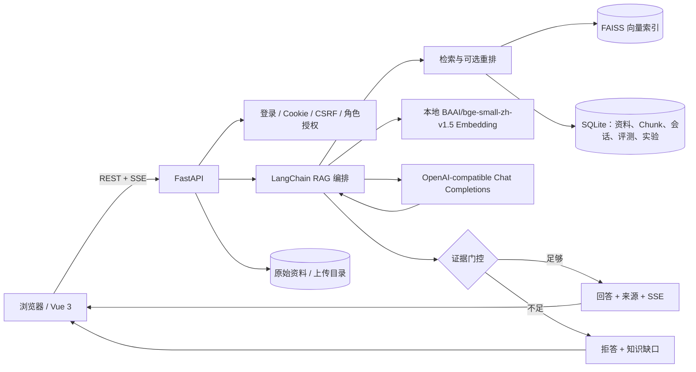

# LaborQA 项目简介与系统架构

> 考核候选环境记录日期：2026-11-17 
> 状态：本地隔离候选；未部署到公网，未发布为正式版本。

## 项目定位

LaborQA（Labor Rights QA）是面向劳动权益场景的证据优先型 RAG 问答与知识运营平台。系统把法规、政策和案例整理为可检索资料，回答时展示命中文件及原文片段。证据不足时应拒答，并把缺失方向沉淀为知识缺口，供管理员维护。

产品是劳动权益信息辅助工具，不替代律师、仲裁机构、行政机关或其他专业人士提供的正式法律意见。输出质量受资料范围、法规时效、检索参数和模型服务影响。

## 架构

生产拓扑由 Caddy 终止 HTTPS，Nginx 提供静态资源、SPA fallback 和 `/api` 代理，FastAPI 提供业务 API；本轮浏览器验收使用 Vite 开发服务器和本机 FastAPI，不能代表 HTTPS 生产代理已验证。SQLite 保存业务真源，FAISS 是可重建的检索索引。

## 主要处理链路

1. 用户登录后，浏览器通过受保护 API 建立或恢复会话；写请求经过 CSRF 与角色检查。
2. 多轮上下文按会话隔离，问题改写后用本地 Embedding 检索 FAISS 候选 Chunk。
3. 服务读取 SQLite 中的 Chunk 和来源元数据，按配置执行轻量排序、可选重排及邻接扩展。
4. 证据判断链决定完整回答、部分回答、工具结果或拒答。
5. 回答以 SSE 推送状态、回答片段、引用和完成事件；资料不足的生产拒答写入知识缺口。
6. 评测和检索实验复用 RAG 服务，但结果保存在候选数据库；策略实验使用独立实验索引，不替换生产索引。

## 功能模块

| 模块 | 当前代码能力 |
| --- | --- |
| 问答 | 多轮会话、SSE、证据判断、来源片段、合规提示、拒答 |
| 资料 | PDF、DOC/DOCX、Markdown、TXT 等解析，系统内置资料导入、分块和索引 |
| 知识运营 | 按主题聚合知识缺口，可维护状态和备注 |
| 身份与权限 | USER、KNOWLEDGE_ADMIN、SYSTEM_ADMIN；会话 Cookie、CSRF、登录限流、服务端角色校验 |
| 评测 | 版本化内置问答基准、后台运行、逐题结果和汇总指标 |
| 检索实验 | 可追踪策略版本、比较策略配置、保留实验结果和配置快照 |
| 运维 | 健康状态、SQLite / 文件持久化、Docker Compose + Caddy + Nginx 部署方案 |

代码能力、自动化测试、真实浏览器验收和已部署验证是不同状态，逐项状态见[功能验收记录](./02_功能验收记录.md)。

## 本轮隔离验收环境

| 项目 | 实际配置 |
| --- | --- |
| Python | 3.11.16 |
| Node.js / npm | 24.22.3 / 11.19.1 |
| LLM | `deepseek-flash`，经 `api.deepseek.com` 的 OpenAI-compatible API 调用；不在文档记录凭据 |
| Embedding | 本地 `BAAI/bge-small-zh-v1.5`，向量维度 512 |
| Chunk | 600 字符，重叠 100 |
| 检索 | Candidate K=20，Top K=5，相似度阈值 0.35 |
| 重排 | 轻量重排开启，完整重排关闭 |
| AI 模式 | 均衡 |
| 知识库 | 10 份内置资料导入成功，705 个 Chunk |
| 隔离范围 | 新建 SQLite、FAISS 和 uploads 目录；不复用或更改原业务数据库与索引 |

本机候选服务地址为 `http://127.0.0.1:5173`（前端）和 `http://127.0.0.1:18000`（后端）。服务只绑定 loopback。测试管理员只在临时候选环境中使用，凭据不写入仓库。

## 关联材料

- [功能验收记录](./02_功能验收记录.md)
- [Baseline v4 评测报告](./03_基准评测报告.md)
- [检索策略对照实验](./04_检索策略对照实验.md)
- [演示流程与问答准备](./05_演示流程与问答准备.md)
- [部署与恢复记录](./06_部署与恢复记录.md)
- [考核版本发布说明](./07_考核版本发布说明.md)
